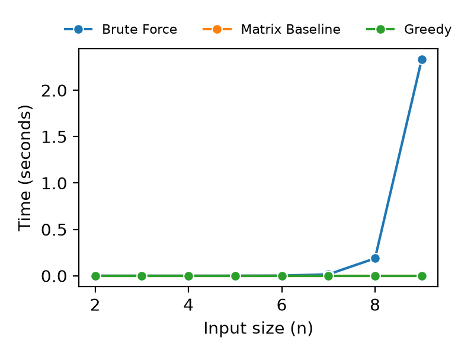
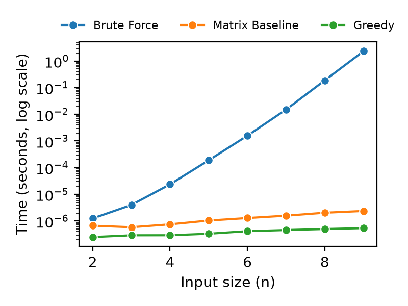
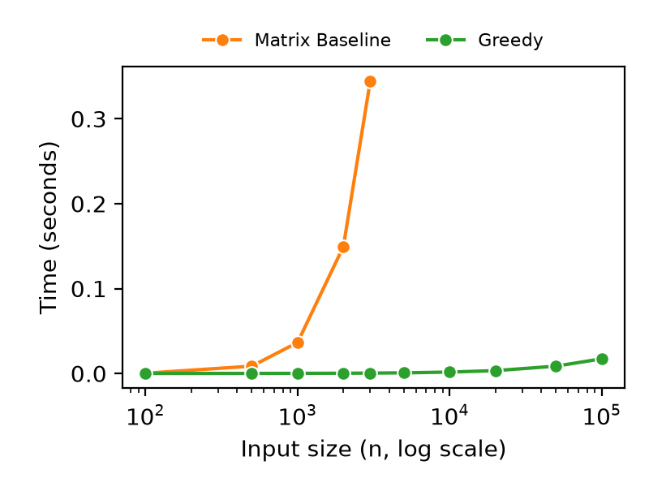
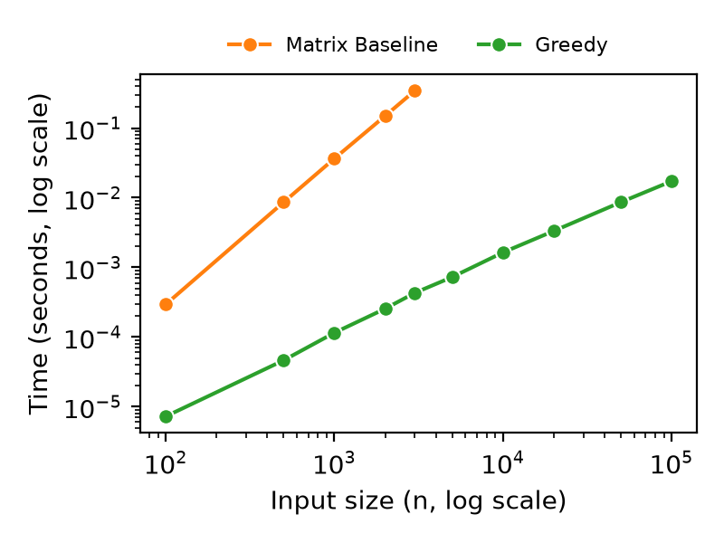

# Mentor Pairing Problem

This document looks into the implementation, results, and performance analysis of our solutions to the Mentor Pairing problem. The goal is to maximise the number of mentor to incoming student pairs while making sure that each of the senior's values were greater than the incoming student's value. We compare two baselines approaches against our proposed greedy algorithm to determine which solution provides the best performance while staying accurate

## Problem Formulation

The objective of the Mentor Pairing problem is to efficiently pair two students based on experience, maximizing the total number of pairs. We are provided with a list of senior students of size $n$ denoted as $Senior = [s_1, s_2, \dots, s_n]$ and another list of incoming students of size $k$ denoted as $Incoming = [a_1, a_2, \dots, a_k]$, with each list containing their programming experience scores. Each student can only be paired one time, and a senior student can only be paired with an incoming student if the senior student has a greater programming experience score than the incoming student. Our goal is to design an algorithm that determines the absolute maximum number of mentor pairings of senior and incoming students, scaling efficiently even when the lists of students are very large.

## Implementation

We implemented three different algorithms into src.methods.py to solve the Mentor Pairing problem. The algorithms include a Brute Force Approach, a Matric Based Baseline, and our Proposed Greedy Solution. The Brute Force Algorithm recursively explores every possible combination for each incoming student. It considers leaving a student unmatched or pairing them with any available senior whose experience score is strictly greater than theirs. By exploring all valid possibilities it determines the maximum number of possible pairings. The issue is that the number of possibilities increase exponentially as the input size grows, making this algorithm impracticaly for large scale inputs. The Matrix Baseline Algorithm sorts the Incoming Student and Senior Student lists, then makes a matrix containing every possible incoming-to-senior student combination, and finally scans the matrix to identify valid pairings. This avoids the exhaustive search performed by the Brute Force method. And finally the Greedy Algorithm is our proposed solution. It sorts both lists in ascending order lists in ascending order and uses two pointers to identify valid pairings. The algorithm matches the least experienced remaining Incoming Student with the least experienced available Seniro Student who can mentor them. If the current seniors value is to low, making them unable to pair with the incoming student, the algorithm skips that senior and considers the next one. This approach avoids unnecessary comparisons and eliminates the need to make a matrix.

## Results

We compared the performances of our three algorithms using randomly generated inputs in src/benchmark.py. Incoming Students scores ranged from 1-500, while the Senior Student scores ranged from 501-1,000. This distribution makes sure that every senior can mentor ever incoming student, creating the largest number of possible pairings. Each input size is measured over five trials, and we used the median execution time to compare performance. A fixed ranom seed of 42 ensures that the benchmark data is reproducible. We also conduct two experiments, the first compares all three algorithms using input sizes ranging from 2 to 9 students per list, while the second exmaines the scalability of the matrix baseline and greedy algorithm using input sizes ranging from 100 to 100,000 students per list. We excluded the Brute Force method from the second experiment because the exponential increase in time makes it impractical for larger inputs. We also limit the Matrix Baseline to input sizes of at most 3,000 because of its quadratic memory requirements. The empirical results are saved in assets/empirical_results.csv and visualized in plots.ipynb. The plots below compare the algorithms' execution times and demonstrate how their perofmrance changes as input size increases

## Experiment 1: Comparing the Three Algorithms

The left plot shows the execution time on a linear scale. In this plot, once the input size reaches 9 students per list, it takes about 2.3 seconds for the Brute Force Algorithm to execute, which is why we do not run it beyond that size. The right plot uses a logarithmic scale for the y axis. The reason for this is to make the graph more readable, as it is impossible to tell where the Matrix Baseline is on the linear scale. After switching to a logarithmic scale for the y axis, notice that the Matrix Baseline is slower than the Greedy Algorithm because the entirety of the Matrix Baseline's line segments, from 2 through 9 students per list, is above the Greedy Algorithm's line segments.

|  |  |
| --- | --- |

## Experiment 2 Scalability

Next, we compare the performance of the Matrix Baseline and Greedy Algorithm for more clarity on which one is better at much higher input sizes. The Matrix Baseline is only measured up to $n = 3{,}000$ because its matrix of every possible pair stores $n^2$ tuples, which already requires roughly 600 MB at that size (see `MAX_BASELINE_SIZE` in `src/benchmark.py`). This memory cost is itself evidence of the $\mathcal{O}(n^2)$ space bound given in our Complexity Analysis. The left plot uses a logarithmic scale for the input size on the x axis and a linear scale for execution time on the y axis, while the right plot uses logarithmic scales for both axes. Again, we made the execution time axis logarithmic to show the difference in execution time more distinctly. This shows no clear overlap between the line segments. The log-log plot also lets us read the growth rate directly: a running time of the form $n^c$ appears as a straight line of slope $c$. Fitting the measured medians gives a slope of 2.08 for the Matrix Baseline and 1.13 for the Greedy Algorithm, which is consistent with the $\mathcal{O}(n^2)$ and $\mathcal{O}(n \log n)$ bounds in our Complexity Analysis.

|  |  |
| --- | --- |

The empirical data aligns with our theoretical complexity analysis:

- **Brute Force Exponential Scaling:** The Brute Force Algorithm has a worst-case upper bound of $\mathcal{O}(n(n+1)^n)$ due to exhaustively exploring the possible matching decisions for every incoming student.
- **Matrix Baseline Quadratic Scaling:** The Matrix Baseline theoretically scales at $\mathcal{O}(n^2)$ due to constructing a $k$ by $n$ matrix containing every possible incoming-senior pair. At $n = 9$, the Matrix Baseline is orders of magnitude faster than the Brute Force Algorithm. The Matrix Baseline is almost **1,000,000 times faster**, demonstrating the advantage of replacing exhaustive combinatorial search with a structured scan, even though the Matrix Baseline still requires quadratic time and space.
- **Greedy Algorithm Efficiency:** The Greedy Algorithm scales at $\mathcal{O}(n \log n)$, constrained almost entirely by Python's built-in sorting algorithm. Sorting 100,000 students per list and performing the $\mathcal{O}(n)$ two-pointer traversal takes just 0.0173 seconds. At $n = 3{,}000$, the Greedy Algorithm is several orders of magnitude faster than the Matrix Baseline. In particular, the Greedy Algorithm is approximately **800 times faster**.

## Correctness Analysis

All three algorithms return the maximum number of valid mentor pairings, where a senior can only be paired with an incoming student whose score is strictly lower than theirs.

**Brute Force Algorithm.** The Brute Force Algorithm returns the maximum possible number of pairings because it considers every possible valid decision for every incoming student. For each incoming student, it explores leaving that student unmatched as well as pairing them with every valid senior who has not already been used. Every valid matching therefore corresponds to at least one path through the recursion tree, and returning the maximum over all paths guarantees the optimal answer.

**Matrix Based Algorithm.** Because both lists are sorted, any senior who cannot mentor the current lowest-scoring incoming student cannot mentor any later incoming student either, so skipping that senior cannot reduce the maximum number of matches. When a valid senior is found, selecting the lowest-scoring available senior preserves all higher-scoring seniors for later incoming students. Repeating these decisions produces the maximum possible number of valid pairings.

**Greedy Algorithm.** Let $s$ and $a$ be the lowest-scoring remaining senior and incoming students. If $s \le a$, then $s$ cannot mentor any remaining incoming student, so skipping $s$ cannot reduce the maximum number of matches. If $s > a$, the algorithm pairs them, and an optimal matching containing this pair always exists. If both are matched to different students in an optimal matching, with pairs $(s, a')$ and $(s', a)$, we can replace them with $(s, a)$ and $(s', a')$. Both new pairs are valid because $s > a$ and $s' \ge s > a'$. In both cases the greedy decision preserves the maximum achievable number of matches, and applying this reasoning repeatedly to the remaining students proves that the algorithm returns the maximum possible number of valid pairings.

## Complexity Analysis

**Brute Force Algorithm.** The Brute Force Algorithm explores every possible matching decisions for each incoming student. At each recursive level a student can remain unmatched or be paired with an available senior whose score is strictly greater than theirs. For two lists of equal length (n), a loos upper bound on the number of choices at each of the (n) recursive levels is (n+1). Each recursive call can also scan up to (n) senior students. This gives a loose upper bound of (O(n(n+1)^2)) time, which is exponential. The algorithm uses an (O(n)) Boolean array to track assigned seniors and has a maximum recursion depth of (O(n)), giving (O(n)) auxilary spave.

**Matrix Based Algorithm.** The Matrix Baseline first sorts both lists, requiring (O(n\log n+k\log k)) where (n) is the number of senior students and (k) is the number of incoming students. It then constructs a matrix containing all (nk) possible pairs, requiring (O(nk)) time and space. The subsequent scan requires (O(n+k)) time because the pointers only advance through the lists. Therefore the total time complexity is O(n\log n+k\log k+nk+n+k). However, when both lists have equal length, this simplifies down to (O(n^2)) time and auxilary spaces.

**Greedy Algorithms.** The greedy algorithm sorts both lists, requiring (O(n\log n+k\log k)) time. After sorting the two pointer traversal requires (O(n+k)) time because each pointer moves forward through its list at most once. The total time complexity is O(n\log n+k\log k+n+k). However, like the Matrix Based Algorithm when both lists have equal length it simplifies down to (O(n\log n)) time. The implementation creates sorted copies of both input lists, requiring (O(n+k)) additional spaces. The two pointer traversal itself requires only (O(1)) additional space

## Conclusion

Our experiments show that the choice of algorithm signficantly affects the performance of the Mentor Pairing provlem. The Brute Force Algorithm guarantees an optimal answer by exploring every possible matching, but the exponential running time makes it unsuitable for large inputs. The Matrix Baseline improves on Brute Force but still requires quadratic time and space because it constructs every possible incoming-to-senior pair. Our proposed greedy algorithm achieves the same objective without exhaustive search or unnecessary matric construction. By sorting both lists and using two pointers it achieves (O(n\log n)) time complexity when both lists have equal length. The accuracy tests, randomized comparisons, benchmark measurements, and empirical growth rates support our conclusion that the Greedy Algorithm is the most efficient of the three approaches. Overall this project shows how choosing an appropriate algorithm can substantially improve execution time and memory usage. Replacing exhaustive search with a structured approach and eliminating unnecessary data storage allows the greedy algorithm to solve much larger instances of the Mentor Pairing problem efficiently